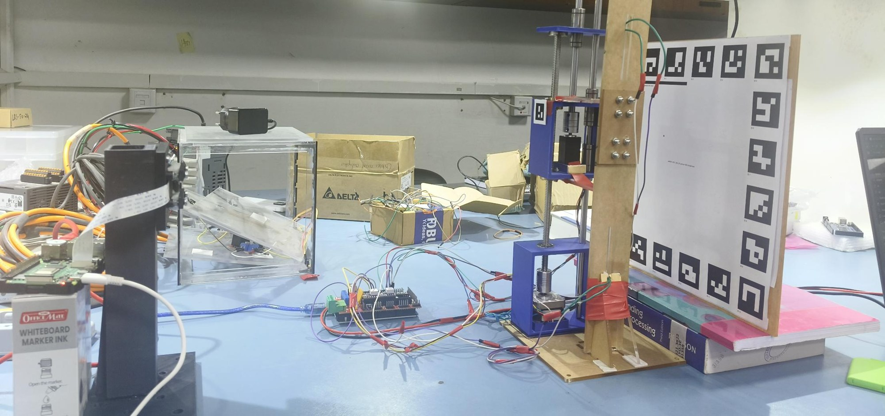
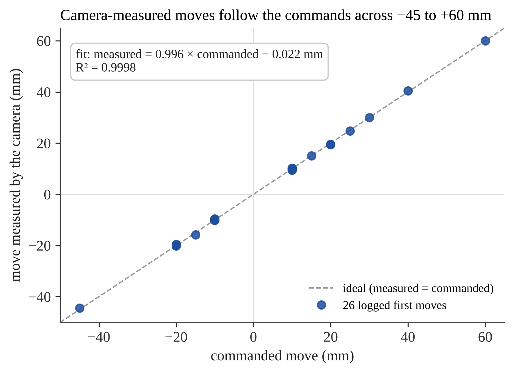
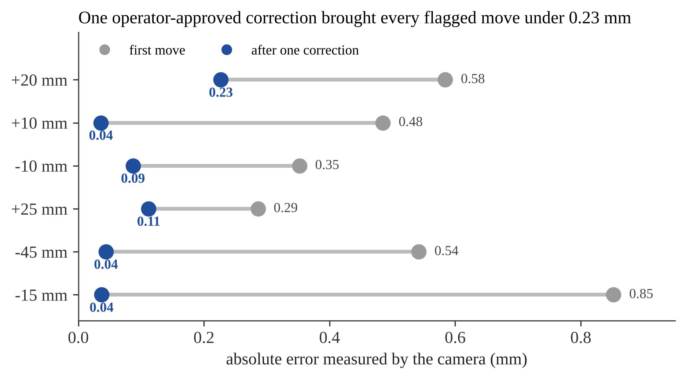
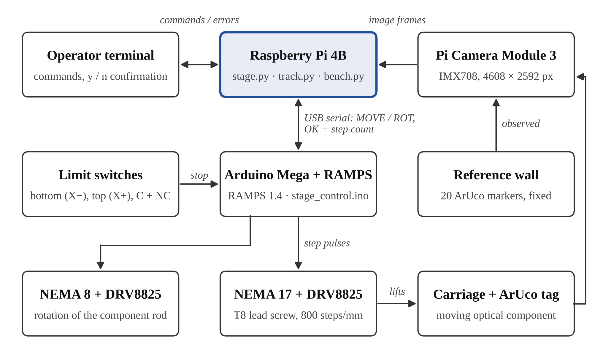
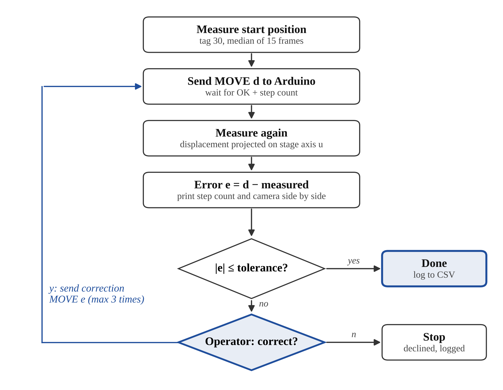

# Reconfigurable Optical Bench — Vision Measurement & Camera-Verified Motion Control

A low-cost laboratory model of a **reconfigurable optical bench**: a camera measures where the bench components are, a motorized stage moves them on command, and every move is verified by the camera and corrected after operator confirmation, in the same way a ground station adjusts an instrument on a satellite.

Hardware: Raspberry Pi 4B + Camera Module 3, Arduino Mega 2560 + RAMPS 1.4 + DRV8825, NEMA 17 lead-screw stage (T8, 8 mm lead) and NEMA 8 rotation axis, printed ArUco markers.



## Results

| Measurement | Result |
|---|---|
| Position on the reference plane (15 checkerboard corners, 449–578 mm camera distance) | 0.14–0.16 mm RMS |
| Position in front of the reference (gap 40–92 mm, gap known) | 0.09–0.19 mm |
| Tag tracking stability (17 min) | ±0.04 mm |
| Stage resolution / accuracy (vernier) | 800 microsteps/mm / ±0.1 mm |
| Camera-measured vs commanded moves (26 moves, −45 to +60 mm) | slope 0.996, R² = 0.9998 |
| Closed-loop correction | every flagged move brought within 0.23 mm in one step |

Known limit: with the tag 178 mm in front of the reference, the camera shows a position-dependent bias of up to 0.45 mm, so the correction tolerance in that geometry is 0.5 mm. A smaller tag-to-reference gap (40–90 mm) restores 0.1–0.2 mm accuracy.

<p>
 
</p>

## How it works



1. **Reference wall** — 20 ArUco markers (DICT_4X4_50, IDs 0–19) on a 300 × 300 mm board. Its pose is recovered in every frame (homography + IPPE/LM PnP), so the camera can be moved without recalibration.
2. **Component tags** — 20 mm ArUco tags (IDs 30–49). The camera ray through each tag centre is intersected with the plane at the tag's gap from the wall.
3. **Stage firmware** — plain-text serial commands (`HOME`, `MOVE`, `GOTO`, `ROT`, `STATUS` …), fail-safe limit switches (C + NC wiring), soft limits, trapezoidal motion.
4. **Closed loop** — `stage.py` measures the tag before and after each move, projects the displacement onto the calibrated axis, reports the error next to the step count, and asks before sending a correction. Every step is logged to CSV.



## Repository layout

```
pi/            Raspberry Pi programs (copy to ~/camera_calibration/bench)
  bench.py         wall detection, validation, manual measurement
  track.py         live tag tracking (fixed-gap and auto-gap modes)
  recalibrate.py   full-frame lens calibration with view rejection
  stage.py         closed-loop ground-station shell for the motorized stage
  synth_test.py    synthetic-image tests of the geometry
  wall_board.json  marker geometry of the 300 mm reference wall
firmware/      Arduino Mega + RAMPS 1.4 sketches (stage_control, motor_test, endstop_test)
targets/       reference wall and component-tag generators + print-ready PDFs (print at 100 %)
fabrication/   laser-cut base plate, fit coupon and switch column (5 mm acrylic; DXF/SVG/PLT + generators)
docs/          wiring diagrams, result figures and photos
```

## Quick start

```bash
# Raspberry Pi
pip install -r requirements.txt --break-system-packages
mkdir -p ~/camera_calibration/bench && cp pi/* ~/camera_calibration/bench/ && cd ~/camera_calibration/bench
python3 recalibrate.py --image-dir ~/camera_calibration/wall_views --aruco-board wall_board.json   # lens calibration
python3 track.py track --once --lens-position 1.45
python3 stage.py status                    # Arduino link
python3 stage.py calibrate-axis --id 30 --dist 50 --lens-position 1.45
python3 stage.py shell --id 30 --lens-position 1.45 --frames 15 --tol 0.5
#   inside the shell: home, move 20, goto 60, rot 90, where, status, quit
```

Upload `firmware/stage_control/stage_control.ino` to the Mega (115200 baud, newline). Set the DRV8825 current with I = 2 × V_ref **before** connecting motors, and never plug or unplug a motor while the board is powered.

## Credits

Developed by **B. Manoj Kumar** as a B.Tech project in the Department of Astronomy, Astrophysics and Space Engineering, IIT Indore, under the supervision of Dr. Narendra Nath Patra. Vision subsystem, camera mount (Fusion 360), drive electronics, firmware, closed-loop software, laser-cut switch column and all measurements by the author; the motorized lead-screw stage was built by a partner group.
